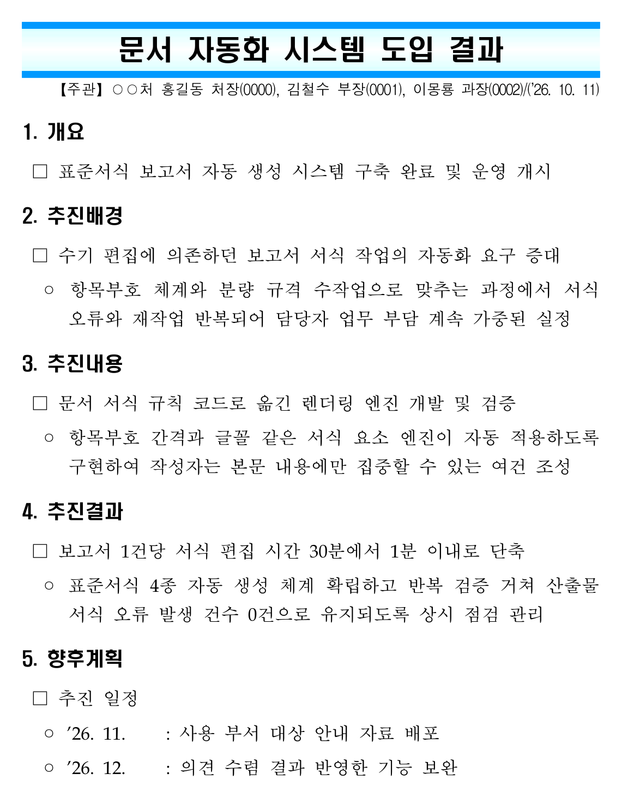

# hwpx-reporter

**한/글(HWP) 프로그램 없이, 공공기관 표준서식 보고서(`.hwpx`)를 만들고 읽는 도구.**
LLM 은 본문 내용만 쓰고, 서식(`□ ◦` 항목부호 · 【주관】 블록 · 휴먼명조 15pt · 간격 · 내어쓰기)은 엔진이 결정론적으로 맞춘다.
한컴오피스가 없는 PC · 서버 · 리눅스에서도 파이썬으로 돈다 — 공문서 · 보고서 자동 작성, HWP/HWPX 문서 자동화.

> 한국수자원공사(K-water) AI혁신처에서 실무 보고서를 쓰려고 만든 프로젝트다. 기관이 공식 배포하는 도구는 아니다.

**이런 분께**
- 같은 서식의 보고서를 한/글로 매번 손보는 공공기관 · 공기업 실무자
- Claude · 사내 챗봇으로 초안을 뽑는데 서식이 자꾸 무너지는 사람
- 한/글 없이 서버 · 리눅스에서 `.hwpx` 를 만들어야 하는 개발자



위 문서가 엔진 출력 그대로다 — 제목박스·【주관】 블록·항목부호·간격을 코드가 맞추고,
본문은 줄 길이(□ 30~38자 · ◦ 66~70자)·어절 경계·종결 규격을 통과한 예시다(렌더 경고 0건).
실물: [docs/example_business_result.hwpx](docs/example_business_result.hwpx)

**바로 써 보기 — 셋 중 하나**

| 어디서 | 어떻게 |
|---|---|
| claude.ai · Claude Code | 스킬 zip 둘을 만들어 올린다 — 파이썬 설치 없이 대화로 → [스킬 타입](#스킬-타입) |
| Claude Desktop 등 MCP 호스트 | 패키지를 설치하고 `mcpServers` 에 등록 → [그 밖의 패키지](#그-밖의-패키지) |
| 파이썬 | `hwpx_skeleton.render("result", ...)` → [파이썬에서 직접](#파이썬에서-직접) |

> **공개판 안내** — 개발은 비공개 리포에서 이어지고(회사 자료가 섞여 있다), 정리된 것을 여기로 옮겨 온다.
> 마지막으로 옮긴 날 2026-10-14. 써 보다 막히는 곳 · 다른 기관 서식 사례는 [이슈](https://github.com/Eum-Jium/hwpx-reporter/issues)로 알려 주면 반영한다.

---

## 두 가지 타입

| 타입 | 어디서 쓰나 | 들어 있는 곳 |
|---|---|---|
| **스킬** | claude.ai · Claude Code 에서 대화로 | [`skill/`](skill/) — 엔진 스킬(`hwpx`) + 양식 스킬(`hwpx-template`) |
| **MCP** | K-water 사내 챗봇(GenOS — Flowise 기반 에이전트 플랫폼) | [`mcp/`](mcp/) — MCP 도구 11종 + 워크플로 + 프롬프트 |

두 타입은 같은 엔진(`packages/` 의 hwpx-core · hwpx-skeleton)과 같은 작성 규칙을 쓴다 —
같은 원고면 같은 문서가 나온다.

### 스킬 타입

파이썬 환경 없이 대화만으로 쓴다. 클론 후(빌드는 표준 라이브러리만 쓴다):

```bash
python skill/build_skill.py           # 엔진 스킬 → build/skill/hwpx-skill-rev<N>.zip
python skill/build_template_skill.py  # 양식 스킬 → build/skill/hwpx-template-skill-rev<N>.zip
```

생성된 zip 둘을 **claude.ai 설정 → 기능(Capabilities) → 스킬**에 업로드하면 끝.
엔진 스킬이 문서를 만들고 읽고, 양식 스킬이 양식 파일과 작성 규칙(골격·문체·줄 길이·표 규격)을 얹는다.
대화에서 "결과보고서 써줘"라고 하면 표준서식 `.hwpx` 를 만들어 주고, 기존 보고서 검토·첨삭도 한다.
엔진 소스가 zip 에 통째로 들어가므로(vendored) claude.ai 쪽 설치는 없다.
Claude Code 사용자는 zip 을 `~/.claude/skills/` 에 풀면 같은 스킬이 로드된다.

### MCP 타입

사내 챗봇에 넣은 보고서 에이전트다. Agentflow 하나(4노드)에서 큰 모델 하나가 도구 여덟을 골라 부르며
골격 → 본문 → 검토 → `.hwpx` 파일까지 사용자와 대화로 만든다. 엔진 휠을 플랫폼 패키지 저장소에 올리고,
도구 파일을 MCP 도구 코드칸에 붙여 넣고, 워크플로를 임포트한 뒤 손으로 채울 자리 몇 곳을 채운다 —
순서·환경변수·도구 목록은 [`mcp/README.md`](mcp/README.md).

---

## 엔진 패키지

| 패키지 | 역할 | 쓰는 타입 |
|---|---|---|
| `hwpx-core` | zip·XML·charmap·HWPUNIT 저수준 툴킷 · 항목부호·간격·표 규격·줄바꿈 폭의 단일 기준 · 메모(검토 의견) 읽기/쓰기 | 스킬 · MCP |
| `hwpx-skeleton` | 표준서식 렌더러 — 양식에 제목·본문·표·그림·붙임을 채운다. 유형 4종 `plain`(기본 문서) · `plan`(계획) · `result`(결과) · `review`(검토보고), 옛 유형 키는 별칭으로 받는다 · 자기 양식은 `template_path=` | 스킬 · MCP |
| `hwpx-reader` | 읽기 — 텍스트·표·구조·메모 추출 | MCP(첨부 원본 파싱 갈래 — 지금은 꺼 둠) |

Python 3.10+ 필요. 가상환경을 권장한다.

```bash
pip install -e packages/hwpx-core -e packages/hwpx-reader -e packages/hwpx-skeleton -e packages/hwpx-writer -e packages/hwpx-report-policy
```

> ⚠️ **다섯 개를 한 번에 설치한다**(아래 「그 밖의 패키지」 둘 포함 — 시험이 함께 돈다). 이 패키지들은
> PyPI 에 게시돼 있지 않으므로 로컬 경로로 함께 설치해야 한다.
>
> 서로를 의존성으로 **선언하지는 않는다** — 없는 이름을 적어 두면 한 개만 설치할 때
> pip 이 공개 PyPI 에서 같은 이름을 찾고(dependency confusion), 누가 선점해 뒀다면
> 엉뚱한 패키지가 들어온다. 대신 **임포트 시점에** `hwpx_core.require_version()`
> 이 판을 확인하고, 어긋나면 위 설치 명령을 알려 주며 멈춘다. 선언이 다시
> 기어들어오지 않게 `test_packaging.py` 가 막는다.

문서를 **열어 볼** PC 에는 폰트가 필요하다 — 휴먼명조 · HY헤드라인M · 한양중고딕 · 맑은 고딕.
없어도 파일 생성은 되지만 한/글에서 대체 글꼴로 보인다.

### 파이썬에서 직접

```python
import hwpx_skeleton as HS

r = HS.render(
    "result",
    {"title": "문서 자동화 시스템 도입 결과"},
    output_dir="./output",
    body=("1. 추진결과\n □ 보고서 서식 편집 시간 단축\n"
          "  ◦ 1건당 30분에서 1분 이내로 줄여 작성 부담 경감\n"
          "2. 향후계획\n □ ’26. 11월\t사용 부서 대상 안내 자료 배포"),
)
print(r["status"], r["path"])
print(r["warnings"])   # 분량·골격·종결 규격에 어긋난 줄을 알려 준다(고치지는 않는다)
```

### 시험

```bash
pip install pytest
pytest packages
```

---

## 그 밖의 패키지

두 타입이 쓰지는 않지만 함께 둔다.

| 패키지 | 역할 |
|---|---|
| `hwpx-writer` | 자유 구성 문서 생성 MCP 서버(**13 툴**) — 양식 없이 섹션·항목·표·이미지를 블록으로 조립한다. 배포 이름 `hwpx-mcp` · import `hwpx_mcp` |
| `hwpx-report-policy` | 작은 모델(7B 급)용 출력 보정 계층 — 한자 거부 · 본문 복구 · 분량 재작성 · 렌더 구제. 콜백 3개만 주입하고, 강한 모델이면 통째로 빼도 엔진은 그대로 돈다 |

엔진 패키지와 writer 는 **단독 MCP 서버**로도 띄울 수 있다(Claude Desktop 등 MCP 호스트에 직접 붙일 때):

```json
{
  "mcpServers": {
    "hwpx-skeleton": { "command": "hwpx-skeleton-mcp" },
    "hwpx-reader":   { "command": "hwpx-reader-mcp" },
    "hwpx-writer":   { "command": "hwpx-mcp" }
  }
}
```

툴은 skeleton 3 · reader 7 · writer 13 이다. 가상환경에 설치했다면 `command` 에 그 환경의 실행 파일
절대경로를 적는다(호스트의 PATH 에는 가상환경이 없다). 출력 폴더는 `HWPX_SKELETON_STORAGE` ·
`HWPX_MCP_STORAGE`, 읽기 서버가 읽을 수 있는 경로는 `HWPX_READER_ROOT` 로 묶는다(상시 서버라면 지정 권장).

---

## 코드를 읽을 때

주석에 자주 나오는 낱말 셋 — **정본**은 기준으로 삼은 표준서식 견본(실측값의 출처)이거나 이 리포를
뽑아 낸 비공개 원본이다. **V4** 는 `mcp/` 보고서 에이전트의 4판이고, 스킬의 재는 기계가 거기서 왔다.
**모드 A · B · C** 는 엔진 스킬의 세 갈래(양식 렌더 · 블록 조립 · 검토 메모)다.

---

## 함께 만든 사람

한국수자원공사 AI혁신처에서 함께 진행한 프로젝트다.
`hwpx-writer` 의 서버 골격·문서 저장소·작성 프롬프트와 표 테두리·열 너비 규칙은
이승준([@tmdwnsdl](https://github.com/tmdwnsdl))과 함께 만든 [kor_hwpx_generator](https://github.com/tmdwnsdl/kor_hwpx_generator)에서 출발했다.

## 라이선스

MIT — [LICENSE](LICENSE) 참조.
이슈(질문 · 버그 · 다른 기관 서식 사례)는 환영한다. PR 은 받지 않는다 — 코드는 비공개 원본에서 옮겨 온다.
포크해서 고쳐 쓰는 건 자유다.

`hwpx-writer` 는 [python-hwpx](https://pypi.org/project/python-hwpx/) 2.18.0 에 의존한다
(private API 결합으로 정확 버전 핀 필수).

---

## In English

**hwpx-reporter** creates and reads Korean government-standard report documents (`.hwpx`, the Hangul / Hancom Office format)
**without Hancom Office installed** — on Windows, Linux or a server, from Python.
The LLM writes only the content; the engine deterministically enforces the layout rules
(bullet symbols `□ ◦`, heading blocks, fonts, spacing, indentation, line lengths) and warns about lines that break them.
Use it as a Claude skill (claude.ai / Claude Code), as MCP servers (Claude Desktop and other MCP hosts), or directly from Python.
Built at K-water (Korea Water Resources Corporation) for real reports; not an official distribution of the agency.
MIT licensed. Documentation is in Korean; issues in English are welcome.
